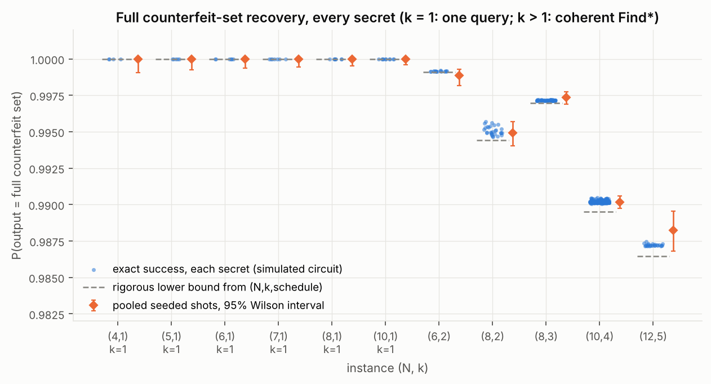

# Quantum Counterfeit Coin Solver

A tested, coherent, gate-level implementation of the **multi-counterfeit** algorithm of Iwama, Nishimura, Raymond & Teruyama, *Quantum Counterfeit Coin Problems* (TCS 456, 2012; [arXiv:1009.0416](https://arxiv.org/abs/1009.0416)): find **all** `k` counterfeit coins among `N` using a balance that only answers *balanced* or *tilted*.

> **Status: the coherent multi-counterfeit (`k > 1`) solver works, in its bounded-error form, under the actual binary equal-pan balance oracle** — every secret of `(N,k) = (6,2), (8,2), (8,3), (10,4)` and 24 sampled secrets of `(12,5)` are recovered with probability ≥ 0.987, using 5 or 9 B-oracle queries counted from the circuit itself. The exact algorithm `Find(k)` (Appendix B) is **not** implemented. In the oracle model there is a measured finite-size query separation at `(8,3)`, `(10,4)` and `(12,5)` (e.g. 5 calls: quantum ≥ 0.996 vs any classical strategy ≤ 0.152 at `(10,4)`), none at `(6,2)` and `(8,2)`, and no runtime or hardware advantage anywhere. See [claim status](#claim-status).

## The problem

Secret `x ∈ {0,1}^N` with `wt(x) = k < N/2` (`x_i = 1`: coin `i` is counterfeit; `k` is known). A legal weighing `q ∈ {−1,0,+1}^N` puts equally many coins on each pan; the oracle returns `χ = 0` if `Σ x_i q_i = 0`, else `1`. Quantumly, `O_B|q⟩ = (−1)^χ|q⟩`. Iwama et al. prove `O(k^{1/4})` quantum queries suffice — independent of `N` — versus a classical `Ω(k log(N/k))`.

## How it works

```
|0>_S --W-->  Σ_{s even} |s>                         uniform even-weight selections   (paper App. A)
      --A-->  Σ_s |s> Σ_{equal splits of I(s)} |split>  coherent, s-controlled           (new circuit)
      --U-->  amplify BALANCED weighings in every branch at once                         (YLC fixed point)
      --O_B-> phase −1 on TILTED weighings                                               (1 query)
      --U†->  workspace returns to ~|0>;  S holds  Σ_s (−1)^{s·x} |s>  approximately
      --W†->  |x>, measure
```

The key fact (paper, Lemma 2): if `s` selects an **odd** number `m` of counterfeits, no equal split can balance (`p = 0`); if `m` is **even**, a random equal split balances with probability `p ≥ 1/√(2m)`. Amplifying "balanced" and flipping the phase of "tilted" therefore writes the parity `(−1)^m = (−1)^{s·x}` onto `s`, and Bernstein–Vazirani-style decoding reveals `x`.

Two pieces the paper leaves at the level of "prepare this state" / "run QSearch" had to be engineered:

1. **Coherent partition preparation `A`** — reversible selection sampling, controlled by the superposed `s`, polynomial size, counters that clean themselves (`state_prep.py`).
2. **Coherent amplification** — the paper's `QSearch` measures, which would collapse the superposition over `s`, and no fixed number of ordinary Grover iterations amplifies all branches (their `p` differ). We use Yoder–Low–Chuang fixed-point amplification with an exact, secret-independent lower bound `p_min(N,k)`. It is therefore a **bounded-error, paper-inspired implementation** of the balance-to-parity step

Details, equations and a component-by-component fidelity table: [`docs/algorithm.md`](docs/algorithm.md).

## Results

| (N,k) | secrets | qubits | B-queries (δ=0.1) | worst exact success | rigorous bound | compiled CX | tuned: B-queries / worst success | classical optimum (weighings, exact) | classical max success with same # calls (δ=0.1 / tuned) |
|---|---|---|---|---|---|---|---|---|---|
| (4,1) | 4 (all) | 17 | 1 | 1.0000 | 1.0000 | 1,030 | — | 2 | 0.500 |
| (8,1) | 8 (all) | 27 | 1 | 1.0000 | 1.0000 | 3,196 | — | 3 | 0.250 |
| (6,2) | 15 (all) | 27 | 5 | 0.9991 | 0.9991 | 18,568 | 5 / 0.9995 | 4 | 1.000 / 1.000 |
| (8,2) | 28 (all) | 35 | 9 | 0.9946 | 0.9944 | 97,326 | 5 / 0.9989 | 5 | 1.000 / 1.000 |
| (8,3) | 56 (all) | 35 | 5 | 0.9971 | 0.9970 | 57,850 | 5 / 0.9987 | 6 | 0.571 / 0.571 |
| (10,4) | 210 (all) | 40 | 9 | 0.9901 | 0.9895 | 162,072 | 5 / 0.9963 | 8 | 1.000 / **0.152** |
| (12,5) | 24 (sampled) | 44 | 9 | 0.9871 | 0.9865 | — | — | — | 0.646 |

*Exact* = simulation of the full circuit; *rigorous bound* = analytic, valid for every secret; *classical max success* = `2^q / C(N,k)` with `q` the quantum call count (any adaptive or randomised classical strategy, worst secret). Compiled CX: basis `{cx, u}`, Qiskit optimisation level 1. Tuned `(10,4)` was re-simulated on every 5th secret (42 of 210); its rigorous bound (0.9963) covers all 210.



More: [`docs/results.md`](docs/results.md) (all figures and tables, with captions saying what is measured, exact, or theory).

## Claim status

| Claim | Status |
|---|---|
| Reversible B-oracle circuit agrees with `χ` on every input, scratch clean, invalid encodings → identity | implemented and tested (≈2.0 M inputs, 0 mismatches) |
| `k = 1`: one query, success 1 | implemented and tested (`N` = 3–8, 10, every secret) |
| Coherent `s`-controlled uniform balanced-partition preparation | implemented and tested |
| Coherent fixed-point amplification with a rigorous guarantee for every `p ≥ p_min` | implemented and tested (per-branch values measured, match theory to 1e−9) |
| Full bounded-error `k > 1` recovery under the actual balance oracle | **implemented and tested** |
| Query count `2L − 1`, independently counted from the call graph | tested equal |
| Schedule optimisation (fewer queries, same rigorous target) | implemented and tested; improves constants, **not** the `k^{1/4}` exponent |
| `O(k^{1/4})` scaling | **theorem** (Iwama et al.); our large-`k` curves are derived from the implemented schedule, not measured |
| Query separation at equal number of oracle calls | measured at `(8,3)`, `(10,4)`, `(12,5)` (quantum rigorous bound vs classical cap `2^q/C(N,k)`); none at `(6,2)`, `(8,2)` |
| Runtime / hardware advantage | **not claimed** — `k > 1` circuits have ≈2×10⁴–2×10⁵ compiled CX gates |
| Exact `Find(k)` (Appendix B) | **not implemented** ([why](docs/limitations.md#why-the-exact-findk-appendix-b-is-not-implemented)) |
| "First implementation" | **not claimed** ([prior-art review](docs/literature_review.md)) |

Full table: [`docs/implementation_status.md`](docs/implementation_status.md).

## Quick start

```bash
git clone https://github.com/madhavv29/quantum-counterfeit-coins.git && cd quantum-counterfeit-coins
python -m venv .venv && source .venv/bin/activate
python -m pip install -r requirements-lock.txt && python -m pip install -e . --no-deps
# (or, unpinned:  python -m pip install -e ".[test]")

python examples/one_counterfeit.py        # k = 1, one weighing
python examples/multiple_counterfeits.py  # k = 3 of N = 8, coherent Find*

python -m pytest -m "not slow"            # ~200 tests, ~1 min
python -m pytest -m slow                  # exhaustive (10,4) + Aer cross-checks, ~10 min

python experiments/run_all.py             # regenerate every CSV (~35 min on 2 cores); --quick for a smoke run
python experiments/summarize.py           # Markdown tables from the CSVs
python experiments/make_plots.py          # redraw every figure from the CSVs
```

```python
from quantum_counterfeit import BalanceOracle, solve
oracle = BalanceOracle((0, 1, 0, 0, 1, 0, 0, 1))   # the secret lives only in the oracle
print(solve(oracle, seed=0))                       # -> (0, 1, 0, 0, 1, 0, 0, 1)
```

## Repository layout

```
src/quantum_counterfeit/
  model.py          exact classical model: chi, legal queries, p(w,m), p_min(N,k)
  b_oracle.py       reversible bit/phase B-oracle, query counting, NullOracle
  gates.py          multi-controlled helpers, controlled increment/decrement
  state_prep.py     W (App. A), W' (GHZ), coherent partition preparation A, k=1 split
  amplitude.py      YLC fixed-point schedule, guarantees, Grover failure analysis
  parity_approx.py  U = YLC(A, S_t, S_0), parity block U† O_B U
  solver.py         one-coin and Find* circuits, run/decode, branch diagnostics
  sparse_sim.py     exact sparse state-vector simulator (cross-checked with Aer)
  aer_backend.py    Qiskit Aer state vectors and shots (≤ 24 qubits)
  classical.py      greedy and exhaustive-minimax classical solvers
  resources.py      logical inventory and compiled {cx,u} costs
  experiments.py    experiment functions (raw rows with provenance-labelled columns)
tests/              unit, exhaustive and cross-check tests (tags: reference, k1, coherent_multi, aer, slow)
experiments/        configs/, run_all.py, make_plots.py, results/ (CSV, JSON), plots/ (PNG)
docs/               literature_review, algorithm, oracle_contract, implementation_status,
                    benchmark_methodology, limitations, results
```

Environment: Python 3.11+ (results produced on 3.13.17), Qiskit 2.6.1, Qiskit Aer 0.18.0, pinned in `requirements-lock.txt`.

## References

- K. Iwama, H. Nishimura, R. Raymond, J. Teruyama, "Quantum Counterfeit Coin Problems," *Theoretical Computer Science* **456** (2012) 51–64; [arXiv:1009.0416](https://arxiv.org/abs/1009.0416); [DOI:10.1016/j.tcs.2012.05.039](https://doi.org/10.1016/j.tcs.2012.05.039).
- T. J. Yoder, G. H. Low, I. L. Chuang, "Fixed-Point Quantum Search with an Optimal Number of Queries," *PRL* **113**, 210501 (2014); [arXiv:1409.3305](https://arxiv.org/abs/1409.3305).
- G. Brassard, P. Høyer, M. Mosca, A. Tapp, "Quantum amplitude amplification and estimation," *Contemp. Math.* **305** (2002) 53–74.
- B. M. Terhal, J. A. Smolin, "Single quantum querying of a database," *PRA* **58**, 1822 (1998).
- R. Raymond, T. Imamichi, [Qiskit tutorial, `k = 1`](https://notebook.community/antoniomezzacapo/qiskit-tutorial/community/games/quantum_counterfeit_coin_problem); Qiskit community, [hackathon issue #15 (2019)](https://github.com/qiskit-community/qiskit-hackathon-singapore-19/issues/15).
- [Qiskit](https://quantum.cloud.ibm.com/docs/) and [Qiskit Aer](https://qiskit.github.io/qiskit-aer/) documentation.

MIT licensed.
