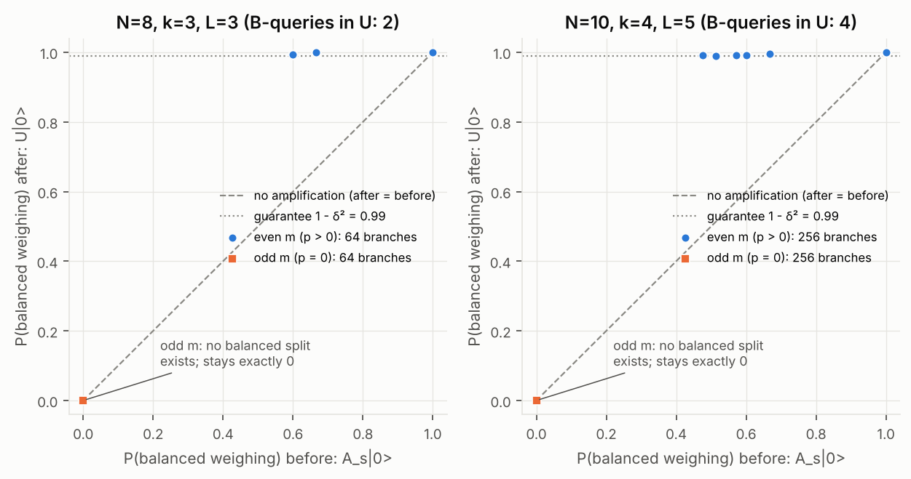
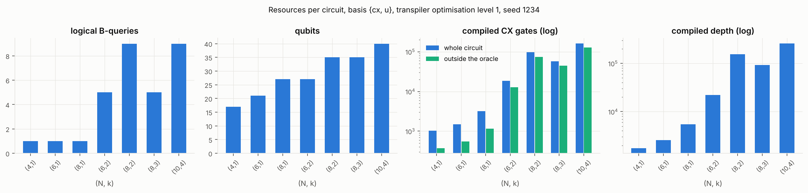
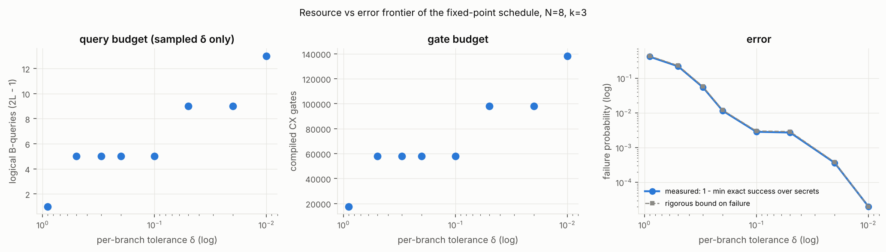
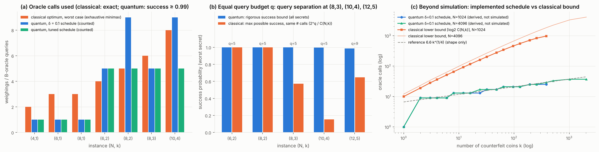
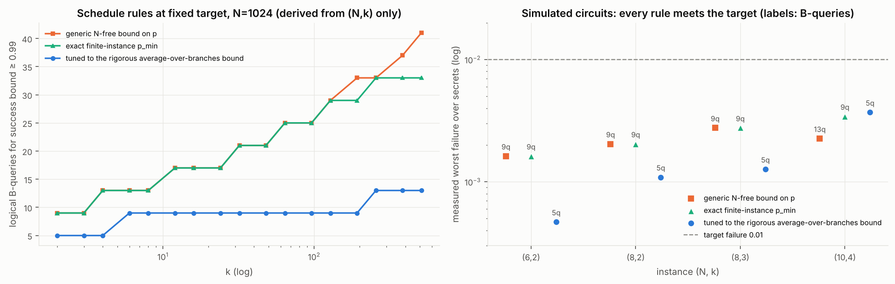

# Results

All numbers below are generated by `experiments/run_all.py` (config `experiments/configs/default.json`) and rendered by `experiments/summarize.py`; figures by `experiments/make_plots.py`. Provenance labels (**exact**, **shots**, **bound**, **schedule-derived**, **theory**) follow [`benchmark_methodology.md`](benchmark_methodology.md).

## Research conclusion

* **Reproduced from the paper.** The balance-oracle model; `W` exactly as in Appendix A; the reduction of counterfeit identification to a parity oracle on even selections; Lemma 2's balanced-split probability (verified exhaustively); and the `Find*(k)` structure — prepare, amplify balanced splits, phase on tilted, uncompute, decode — as one coherent circuit that recovers the full counterfeit set.
* **Newly engineered.** A reversible B-oracle with explicit invalid-encoding semantics; a polynomial-size, `s`-controlled uniform balanced-split preparation whose counters clean themselves; a coherent replacement for `QSearch` (YLC fixed-point amplification from an exact, secret-independent `p_min(N,k)`), needed because `QSearch` measures and fixed-count Grover provably fails here; an exact sparse simulator cross-checked with Aer.
* **Optimised.** A secret-independent schedule tuned to the exact average-over-branches bound: 9 → 5 B-queries (≈40 % fewer CX) at the same rigorous 0.99 target at every simulated size; 29 → 9 at `N = 1024, k = 128` (schedule-derived). Constants only.
* **Measured.** Every secret of `(6,2)`, `(8,2)`, `(8,3)`, `(10,4)` and 24 of `(12,5)` recovered with exact probability ≥ 0.987, always above the rigorous bound; B-queries counted from the circuit equal the schedule's `2L − 1`; a finite-size query separation at `(8,3)`, `(10,4)`, `(12,5)` against a rigorous cap on every classical strategy, and none at `(6,2)`, `(8,2)`.
* **Not established.** The exact `Find(k)`; the `k^{1/4}` exponent from data (it is a theorem, and our curves are schedule-derived); any runtime or hardware advantage; novelty over all prior code.

## 1. Problem and precise oracle model

Secret `x ∈ {0,1}^N`, `wt(x) = k`, `1 ≤ k < N/2`, `k` known. Legal query `q ∈ {−1,0,+1}^N` with equally many `+1` (left) and `−1` (right). Answer `χ(x;q) = 0` iff `Σ_i x_i q_i = 0` (balanced), else `1` (tilted) — binary only. Quantum oracle: `O_{B,x}|q⟩ = (−1)^{χ(x;q)}|q⟩`, realised as a reversible bit oracle on the encoding `(sel, side)` with clean scratch and the identity on unequal-pan encodings ([`oracle_contract.md`](oracle_contract.md)). `x` and `x̄` are indistinguishable, hence `k < N/2`.

The required counterexample holds at both levels (classical model and circuit): with `q = (+1,+1,−1,−1,0,0)`, `x = 110000` tilts and `x = 101000` balances, although both selections contain an even number of counterfeits — so no parity- or membership-style oracle is a valid stand-in for `k > 1`.

## 2. Primary theorem and what it does not imply

**Theorem (Iwama et al. 2012, Thm 1).** `Q(k, N) = O(k^{1/4})` B-oracle queries for exact identification, for all `k < N/2`; classically `Ω(k log(N/k))`.

It does **not** imply: a wall-clock or hardware speed-up (the oracle is a formal query primitive; our circuits have 10³–2×10⁵ CX gates); an advantage at every small `N` (§8 finds a finite-size query separation at some instances and none at others); specific constants (the theorem fixes none — we derive them for our schedule); or tightness (only conditional `Ω(k^{1/4})` lower bounds are proved).

## 3. Algorithmic decomposition and mathematical correctness

`W` (App. A) → coherent partition preparation `A` → YLC fixed-point amplification of *balanced* weighings → `O_B` (phase on *tilted*) → inverse → `W†` → measure. Per branch `s`, the coefficient left on `|s⟩|0⟩` is exactly `−1` when `m = |I(s) ∩ supp x|` is odd (no balanced split exists, `p = 0`) and `2P_L(p) − 1 ≥ 1 − 2δ²` when `m` is even (`p ≥ p_min(N,k)`). The overlap with the ideal output, `F = E_s[(−1)^m v_s]`, depends only on `(N, k, schedule)`, and success `≥ F²`. Derivations: [`algorithm.md`](algorithm.md).

Mathematical facts verified exhaustively (not assumed): `p(s,x)` enumeration = binomial formula for every `(s,x)` with `N ≤ 8` (31 `(w,m)` classes, all verified); `p_min(N,k)` = exhaustive minimum; `p_min ≥ 1/√(2k)` independent of `N` (all `N < 30`); YLC formula = exact 2×2 evolution; fixed-count Grover fails for every `j ≥ 1` on the admissible `p` sets (e.g. `(8,2)`: worst success 0.074, 0.828, 0.006, 0.541, 0.000 for `j = 1…5`).

Finite-instance `p_min` (exact):

| (N,k) | p_min | attained at (w, m) | L at δ = 0.1 | B-queries |
|---|---|---|---|---|
| (6,2) | 3/5 | (6, 2) | 3 | 5 |
| (8,2) | 4/7 | (8, 2) | 5 | 9 |
| (8,3) | 3/5 | (6, 2) | 3 | 5 |
| (10,4) | 10/21 | (10, 4) | 5 | 9 |

## 4. What was actually implemented

See [`implementation_status.md`](implementation_status.md). In short: classical model, reversible B-oracle, `k = 1` solver, coherent `s`-controlled partition preparation, coherent fixed-point amplification, balance-to-parity block, **full coherent bounded-error `k > 1` solver**, classical baselines, and one optimisation. Not implemented: exact `Find(k)` / `Check`.

## 5. Tests and correctness outcomes

`python -m pytest -m "not slow"`: 200+ tests, ≈1 min. `python -m pytest -m slow`: exhaustive `(8,3)` and `(10,4)` solver runs and the Aer state-vector/shot cross-check at `(6,2)`, ≈9 min on 2 cores. All pass in the pinned environment.

* B-oracle: every encoding × every secret for 7 `(N,k)` cases, ≈2.04 M inputs (≈0.43 M legal, ≈1.61 M illegal), **0 mismatches** (`results/oracle_truth_table.csv`).
* `k = 1`: every secret, `N ∈ {3,…,8, 10}`, success 1 to 1e−12, exactly one counted B-query, `(|x⟩+|x̄⟩)/√2` reproduced after the Hadamards.
* Partition preparation: overlap 1 (to 1e−12) with the uniform equal-split state for every even `s`, `N = 4…8`; one coherent simulation over all `s` matches `Σ_s c|s⟩A_s|0⟩`; `A†` restores `|s⟩|0⟩`.
* Parity block: per-branch coefficients and leakage measured from the coherent simulation agree with the 2×2 prediction to 1e−9; odd-`m` branches are exactly `−1` with zero leakage.
* Anti-cheating: guarded oracle, decoy secret attributes, source scan, and a check that the circuit contains no `initialize`/`unitary`/state-preparation instructions.

## 6. Benchmark environment and resource definitions

2-core cloud Linux VM, 7 GB RAM, Python 3.13.17, Qiskit 2.6.1, Qiskit Aer 0.18.0 (`results/run_metadata.json`, `requirements-lock.txt`). Logical B-queries are counted from the circuit call graph; compiled costs use `transpile(basis_gates=["cx","u"], optimization_level=1, seed_transpiler=1234)`; "outside the oracle" costs replace every oracle by an empty instruction. Dense state vectors are limited to 24 qubits (256 MiB); larger circuits use the exact sparse simulator, cross-checked against Aer at 17–23 qubits.

## 7. Results: oracle queries, gates, depth, qubits, success rate

### 7.1 Correctness of the full solver

*Figure 1.* Blue dots: **exact** probability that the measured selection register decodes to the full counterfeit set, one dot per secret, from simulating the complete circuit. Gray dashes: **rigorous lower bound** `F²` computed from `(N, k, schedule)` alone (valid for every secret, including those not simulated at `(12,5)`). Orange: **seeded shots** (1000 per secret, pooled) with 95 % Wilson intervals. Every exact value lies above its bound; shot estimates agree with exact values within sampling error.

| label | N | k | secrets | L | B_queries | schedule_queries | qubits | exact_success_min | exact_success_max | bound | shots_total | shots_success | sim_s_per_secret | final_nonzeros |
|---|---|---|---|---|---|---|---|---|---|---|---|---|---|---|
| one_coin | 4 | 1 | 4 | 1 | 1 | 1 | 17 | 1.000000 | 1.000000 | 1 | 4000 | 1 | 0.040000 | 1 |
| one_coin | 5 | 1 | 5 | 1 | 1 | 1 | 19 | 1.000000 | 1.000000 | 1 | 5000 | 1 | 0.020000 | 1 |
| one_coin | 6 | 1 | 6 | 1 | 1 | 1 | 21 | 1.000000 | 1.000000 | 1 | 6000 | 1 | 0.020000 | 1 |
| one_coin | 7 | 1 | 7 | 1 | 1 | 1 | 23 | 1.000000 | 1.000000 | 1 | 7000 | 1 | 0.020000 | 1 |
| one_coin | 8 | 1 | 8 | 1 | 1 | 1 | 27 | 1.000000 | 1.000000 | 1 | 8000 | 1 | 0.040000 | 1 |
| one_coin | 10 | 1 | 10 | 1 | 1 | 1 | 31 | 1.000000 | 1.000000 | 1 | 10000 | 1 | 0.050000 | 1 |
| find_star | 6 | 2 | 15 | 3 | 5 | 5 | 27 | 0.999132 | 0.999194 | 0.999088 | 15000 | 0.998900 | 0.190000 | 512 |
| find_star | 8 | 2 | 28 | 5 | 9 | 9 | 35 | 0.994638 | 0.995710 | 0.994422 | 28000 | 0.994900 | 0.730000 | 8192 |
| find_star | 8 | 3 | 56 | 3 | 5 | 5 | 35 | 0.997130 | 0.997188 | 0.996979 | 56000 | 0.997400 | 0.500000 | 5592 |
| find_star | 10 | 4 | 210 | 5 | 9 | 9 | 40 | 0.990065 | 0.990469 | 0.989514 | 210000 | 0.990200 | 2.080000 | 131072 |
| find_star_ghz | 6 | 2 | 15 | 3 | 5 | 5 | 23 | 0.999132 | 0.999194 | 0.999088 | 15000 | 0.998800 | 0.360000 | 512 |
| find_star_sampled_secrets | 12 | 5 | 24 | 5 | 9 | 9 | 44 | 0.987138 | 0.987464 | 0.986465 | 24000 | 0.988200 | 10.5 | 1843728 |

`B_queries` is counted from the circuit's call graph; `schedule_queries` is the independent prediction `2L − 1`; they agree in all 388 runs. `find_star_ghz` uses the cheaper `W'`; it gives bit-identical success probabilities. `(12,5)` was run on 24 secrets sampled with seed 99.

**Aer cross-check** (independent simulator, dense state vectors ≤ 24 qubits; Aer runs the circuit after an exactly-verified rewrite of controlled RY gates):

| kind | N | k | w_variant | secrets | qubits | max_abs_amplitude_diff | exact_success_min | aer_shot_success_mean | shots_per_secret | aer_seconds |
|---|---|---|---|---|---|---|---|---|---|---|
| one_coin | 4 | 1 | paper | 4 | 17 | 1.2e-15 | 1.000000 | 1 | 1000 | 1.370000 |
| one_coin | 6 | 1 | ghz | 6 | 17 | 1.5e-15 | 1.000000 | 1 | 1000 | 1.126667 |
| find_star | 6 | 2 | ghz | 5 | 23 | 1.4e-15 | 0.999136 | 0.999000 | 1000 | 76.7 |

### 7.2 Amplification, branch by branch

*Figure 2.* Each point is one selection `s` of the coherent superposition (128 and 512 branches; many coincide). x: **exact** probability of a balanced weighing in `A_s|0⟩`; y: the same after the fixed-point sequence `U`, measured directly from the coherent state by classifying every basis state of the query register. Odd-`m` branches (orange) have no balanced split and remain exactly 0 — this is what makes the phase `−1`. Even-`m` branches rise from `p ≥ p_min` (0.60 and 0.476) to ≥ 0.990, above the guarantee line `1 − δ²`. After `U† O_B U`, odd branches carry coefficient `−1` (deviation ≤ 2e−15, zero leakage); even branches carry ≥ 0.9879 (`(8,3)`) and ≥ 0.9804 (`(10,4)`), with leaked norm √(1 − v²) ≤ 0.155 and ≤ 0.197 respectively (`results/amplification_branches.csv`).

### 7.3 Resources

*Figure 3.* **Counted** B-queries, qubits, and **compiled** CX count and depth (basis `{cx, u}`, optimisation level 1, seed 1234; log scale for gates and depth). Green bars: CX count with every oracle call replaced by an empty instruction — the oracle is 20–32 % of the CX count for `k > 1`, and the partition preparation's multi-controlled rotations dominate the rest.

| N | k | w_variant | L | qubits | counted_queries | logical_ops_total | logical_ops_outside_oracle | max_controls | compiled_cx | compiled_cx_outside_oracle | oracle_call_cx | compiled_1q | compiled_depth |
|---|---|---|---|---|---|---|---|---|---|---|---|---|---|
| 4 | 1 | paper | 1 | 17 | 1 | 142 | 88 | 4 | 1030 | 376 | 618 | 1172 | 1758 |
| 6 | 1 | paper | 1 | 21 | 1 | 208 | 130 | 4 | 1500 | 548 | 898 | 1699 | 2562 |
| 8 | 1 | paper | 1 | 27 | 1 | 338 | 204 | 5 | 3196 | 1160 | 1928 | 3670 | 5477 |
| 6 | 2 | paper | 3 | 27 | 5 | 1040 | 590 | 10 | 18568 | 12666 | 1034 | 20250 | 22005 |
| 8 | 2 | paper | 5 | 35 | 9 | 3024 | 1710 | 14 | 97326 | 73780 | 2064 | 111835 | 155275 |
| 8 | 3 | paper | 3 | 35 | 5 | 1864 | 1094 | 14 | 57850 | 44440 | 2140 | 66653 | 92694 |
| 10 | 4 | paper | 5 | 40 | 9 | 4362 | 2472 | 16 | 162072 | 128808 | 2944 | 187082 | 259562 |
| 6 | 2 | ghz | 3 | 23 | 5 | 958 | 508 | 10 | 17996 | 12128 | 1034 | 19610 | 21037 |

`oracle_call_cx` is the cost of a single compiled `B_oracle`. Per-amplification accounting at δ = 0.1: an amplification sequence `U` uses `L − 1` queries (2 or 4), `U` and `U†` each appear once, and `O_B` adds 1, total `2L − 1`.

### 7.4 Error vs resources (δ sweep)

*Figure 4.* `(N,k) = (8,3)`, 8 secrets (every 7th). Left/middle: **counted** B-queries and **compiled** CX at each sampled δ (L changes only at discrete δ values; points between samples were not computed). Right: **measured** worst failure over the simulated secrets and the **rigorous** failure bound — they nearly coincide. δ = 0.9 forces `L = 1` (no amplification) and fails 42 % of the time: amplification is necessary.

| delta | L | B_queries | secrets | exact_success_min | bound | compiled_cx | compiled_depth |
|---|---|---|---|---|---|---|---|
| 0.900000 | 1 | 1 | 8 | 0.581421 | 0.562500 | 17670 | 27872 |
| 0.500000 | 3 | 5 | 8 | 0.779121 | 0.767784 | 57850 | 92694 |
| 0.300000 | 3 | 5 | 8 | 0.945233 | 0.942311 | 57850 | 92694 |
| 0.200000 | 3 | 5 | 8 | 0.988428 | 0.987918 | 57850 | 92694 |
| 0.100000 | 3 | 5 | 8 | 0.997139 | 0.996979 | 57850 | 92694 |
| 0.050000 | 5 | 9 | 8 | 0.997271 | 0.997096 | 98042 | 156392 |
| 0.020000 | 5 | 9 | 8 | 0.999635 | 0.999619 | 98042 | 156392 |
| 0.010000 | 7 | 13 | 8 | 0.999980 | 0.999980 | 138234 | 220090 |

## 8. Classical comparison under the same oracle restrictions

*Figure 5.* (a) Oracle calls: **exact** classical optimum (exhaustive minimax, worst case over secrets, exact identification) vs the quantum circuit's **counted** B-queries for the δ = 0.1 and tuned schedules (bounded error, success ≥ 0.99). (b) At an **equal budget** of `q` oracle calls: the quantum **rigorous** success bound vs the **best possible** classical success, `2^q / C(N,k)` (a `q`-weighing strategy is a binary decision tree with ≤ `2^q` leaves, so it is right on at most `2^q` secrets; by Yao's principle no randomised strategy does better on its worst secret). (c) Beyond simulation: B-queries implied by the implemented δ = 0.1 schedule (**schedule-derived**, not simulated) vs the classical **information-theoretic lower bound** `⌈log₂ C(N,k)⌉`; the dashed `k^(1/4)` curve is a shape reference only, not a fit.

| N | k | info_lower_bound | minimax_optimal_worst_case | minimax_seconds | greedy_worst_case | greedy_mean | legal_queries | quantum_B_queries | quantum_success_min |
|---|---|---|---|---|---|---|---|---|---|
| 4 | 1 | 2 | 2 | 0 | 2 | 2 | 18 | 1 | 1.000000 |
| 6 | 1 | 3 | 3 | 0 | 3 | 2.666667 | 140 | 1 | 1.000000 |
| 6 | 2 | 4 | 4 | 0 | 4 | 3.933333 | 140 | 5 | 0.999132 |
| 8 | 1 | 3 | 3 | 0 | 3 | 3 | 1106 | 1 | 1.000000 |
| 8 | 2 | 5 | 5 | 0.010000 | 5 | 4.857143 | 1106 | 9 | 0.994638 |
| 8 | 3 | 6 | 6 | 0.010000 | 6 | 5.857143 | 1106 | 5 | 0.997130 |
| 10 | 2 | 6 | 6 | 0.080000 | 6 | 5.577778 | 8952 | — | — |
| 10 | 4 | 8 | 8 | 0.230000 | 8 | 7.780952 | 8952 | 9 | 0.990065 |

Greedy matches the exact optimum in every case; the exact optimum equals the information bound in every case where it was computed.

**Equal-budget comparison** (all numbers rigorous except `quantum_success_min`, which is exact simulation on the listed secrets):

| N | k | schedule | secrets_simulated | B_queries | quantum_success_min | quantum_bound_all_secrets | classical_success_cap | separation |
|---|---|---|---|---|---|---|---|---|
| 4 | 1 | k=1 circuit | 4 | 1 | 1.000000 | 1 | 0.500000 | True |
| 5 | 1 | k=1 circuit | 5 | 1 | 1.000000 | 1 | 0.400000 | True |
| 6 | 1 | k=1 circuit | 6 | 1 | 1.000000 | 1 | 0.333333 | True |
| 7 | 1 | k=1 circuit | 7 | 1 | 1.000000 | 1 | 0.285714 | True |
| 8 | 1 | k=1 circuit | 8 | 1 | 1.000000 | 1 | 0.250000 | True |
| 10 | 1 | k=1 circuit | 10 | 1 | 1.000000 | 1 | 0.200000 | True |
| 6 | 2 | delta=0.1 | 15 | 5 | 0.999132 | 0.999088 | 1 | False |
| 6 | 2 | tuned (target 0.99) | 15 | 5 | 0.999531 | 0.999520 | 1 | False |
| 8 | 2 | delta=0.1 | 28 | 9 | 0.994638 | 0.994422 | 1 | False |
| 8 | 2 | tuned (target 0.99) | 28 | 5 | 0.998910 | 0.998909 | 1 | False |
| 8 | 3 | delta=0.1 | 56 | 5 | 0.997130 | 0.996979 | 0.571429 | True |
| 8 | 3 | tuned (target 0.99) | 56 | 5 | 0.998734 | 0.998733 | 0.571429 | True |
| 10 | 4 | delta=0.1 | 210 | 9 | 0.990065 | 0.989514 | 1 | False |
| 10 | 4 | tuned (target 0.99) | 42 | 5 | 0.996305 | 0.996267 | 0.152381 | True |
| 12 | 5 | delta=0.1 | 24 | 9 | 0.987138 | 0.986465 | 0.646465 | True |

**Reading this honestly.**
* For `k = 1` one quantum query identifies the coin; one classical weighing succeeds with probability ≤ 2/N. This is the known Terhal–Smolin / Bernstein–Vazirani separation, not the paper's contribution.
* For `k > 1` a finite-size **query separation** appears at `(8,3)` (5 calls: quantum ≥ 0.9987 vs classical ≤ 0.571), `(10,4)` (5 calls: ≥ 0.9963 vs ≤ 0.152) and `(12,5)` (9 calls: ≥ 0.9865 vs ≤ 0.646). At `(6,2)` and `(8,2)` there is none: the classical optimum uses no more calls than the circuit.
* This is a statement about oracle calls in a formal black-box model with bounded error. It is **not** a runtime or hardware advantage (each `k > 1` circuit has ≈2×10⁴–2×10⁵ CX gates and the oracle is an instance-specific arithmetic circuit), and three data points do not establish the `k^0.25` exponent.

Schedule-derived query counts at sizes that are not simulated (δ = 0.1):

| N | k | p_min | schedule_L | schedule_queries | bound_success | classical_info_bound |
|---|---|---|---|---|---|---|
| 64 | 2 | 0.507900 | 5 | 9 | 0.990200 | 11 |
| 64 | 4 | 0.387200 | 5 | 9 | 0.984800 | 20 |
| 64 | 8 | 0.292200 | 5 | 9 | 0.993190 | 33 |
| 64 | 16 | 0.226500 | 7 | 13 | 0.982000 | 49 |
| 256 | 2 | 0.502000 | 5 | 9 | 0.990510 | 15 |
| 256 | 4 | 0.378000 | 5 | 9 | 0.985590 | 28 |
| 256 | 8 | 0.277800 | 7 | 13 | 0.988100 | 49 |
| 256 | 16 | 0.202800 | 7 | 13 | 0.985030 | 84 |
| 256 | 32 | 0.149600 | 9 | 17 | 0.981340 | 136 |
| 256 | 64 | 0.114700 | 9 | 17 | 0.990390 | 204 |
| 1024 | 2 | 0.500500 | 5 | 9 | 0.990610 | 19 |
| 1024 | 4 | 0.375700 | 5 | 9 | 0.985800 | 36 |
| 1024 | 8 | 0.274500 | 7 | 13 | 0.987720 | 65 |
| 1024 | 16 | 0.197900 | 7 | 13 | 0.986140 | 116 |
| 1024 | 32 | 0.142200 | 9 | 17 | 0.981740 | 202 |
| 1024 | 64 | 0.102600 | 11 | 21 | 0.980770 | 342 |
| 1024 | 128 | 0.075200 | 11 | 21 | 0.993470 | 552 |
| 1024 | 256 | 0.057500 | 13 | 25 | 0.990550 | 826 |
| 4096 | 2 | 0.500100 | 5 | 9 | 0.990640 | 23 |
| 4096 | 4 | 0.375200 | 5 | 9 | 0.985850 | 44 |
| 4096 | 8 | 0.273700 | 7 | 13 | 0.987640 | 81 |
| 4096 | 16 | 0.196800 | 7 | 13 | 0.986420 | 148 |
| 4096 | 32 | 0.140500 | 9 | 17 | 0.981980 | 267 |
| 4096 | 64 | 0.100100 | 11 | 21 | 0.980890 | 472 |
| 4096 | 128 | 0.071500 | 11 | 21 | 0.996210 | 817 |
| 4096 | 256 | 0.051500 | 13 | 25 | 0.996900 | 1377 |
| 4096 | 512 | 0.037700 | 17 | 33 | 0.985000 | 2221 |
| 4096 | 1024 | 0.028800 | 19 | 37 | 0.987940 | 3317 |
| 4096 | 2047 | 0.024900 | 19 | 37 | 0.996430 | 4090 |

## 9. Optimization and ablation

**What changed.** The amplification length `L` (and δ) is chosen by one of three secret-independent rules, all targeting the same rigorous overall success bound `F² ≥ 0.99`:

* `generic_bound` — per-branch guarantee from the `N`-free analytic bound `p ≥ C(k',k'/2)/2^{k'}` (`k'` = largest even ≤ k), δ = 0.0501 so that `(1 − 2δ²)² ≥ 0.99` — what one gets from the paper's `Ω(1/√k)` without finite-instance analysis;
* `exact_p_min` — same δ, but the exact finite-instance `p_min(N, k)`;
* `tuned_overlap` — smallest `L` (then best δ) such that the **exact** overlap `F(N, k, L, δ)`, which averages over the actual `(w, m)` distribution of branches, satisfies `F² ≥ 0.99`.

**Held fixed:** correctness target (rigorous bound ≥ 0.99), `(N, k)`, secrets (all of `(6,2)`, `(8,2)`, `(8,3)`; every 5th of `(10,4)`), circuit construction, transpiler basis `{cx, u}`, optimisation level 1, seed 1234.

*Figure 6.* Left: **schedule-derived** B-queries at `N = 1024` for each rule. Right: **exact** worst failure of the re-simulated circuits; every rule meets the 1 % target, the tuned rule with 5 instead of 9–13 queries.

| N | k | rule | L | delta | B_queries | secrets | exact_success_min | bound | compiled_cx | compiled_depth |
|---|---|---|---|---|---|---|---|---|---|---|
| 6 | 2 | generic_bound | 5 | 0.050100 | 9 | 15 | 0.998380 | 0.998297 | 31684 | 37193 |
| 6 | 2 | exact_p_min | 5 | 0.050100 | 9 | 15 | 0.998380 | 0.998297 | 31684 | 37193 |
| 6 | 2 | tuned_overlap | 3 | 0.112200 | 5 | 15 | 0.999531 | 0.999520 | 18568 | 22005 |
| 8 | 2 | generic_bound | 5 | 0.050100 | 9 | 28 | 0.997963 | 0.997886 | 97326 | 155275 |
| 8 | 2 | exact_p_min | 5 | 0.050100 | 9 | 28 | 0.997963 | 0.997886 | 97326 | 155275 |
| 8 | 2 | tuned_overlap | 3 | 0.141300 | 5 | 28 | 0.998910 | 0.998909 | 57454 | 92073 |
| 8 | 3 | generic_bound | 5 | 0.050100 | 9 | 56 | 0.997246 | 0.997090 | 98042 | 156392 |
| 8 | 3 | exact_p_min | 5 | 0.050100 | 9 | 56 | 0.997246 | 0.997090 | 98042 | 156392 |
| 8 | 3 | tuned_overlap | 3 | 0.125900 | 5 | 56 | 0.998734 | 0.998733 | 57850 | 92694 |
| 10 | 4 | generic_bound | 7 | 0.050100 | 13 | 42 | 0.997747 | 0.997671 | 228304 | 365082 |
| 10 | 4 | exact_p_min | 5 | 0.050100 | 9 | 42 | 0.996579 | 0.996402 | 162072 | 259562 |
| 10 | 4 | tuned_overlap | 3 | 0.141300 | 5 | 42 | 0.996305 | 0.996267 | 95840 | 154042 |

| N | k | exact_p_min | generic_bound | tuned_overlap |
|---|---|---|---|---|
| 1024 | 2 | 9 | 9 | 5 |
| 1024 | 3 | 9 | 9 | 5 |
| 1024 | 4 | 13 | 13 | 5 |
| 1024 | 6 | 13 | 13 | 9 |
| 1024 | 8 | 13 | 13 | 9 |
| 1024 | 12 | 17 | 17 | 9 |
| 1024 | 16 | 17 | 17 | 9 |
| 1024 | 24 | 17 | 17 | 9 |
| 1024 | 32 | 21 | 21 | 9 |
| 1024 | 48 | 21 | 21 | 9 |
| 1024 | 64 | 25 | 25 | 9 |
| 1024 | 96 | 25 | 25 | 9 |
| 1024 | 128 | 29 | 29 | 9 |
| 1024 | 192 | 29 | 33 | 9 |
| 1024 | 256 | 33 | 33 | 13 |
| 1024 | 384 | 33 | 37 | 13 |
| 1024 | 511 | 33 | 41 | 13 |

**Effect.** At the simulated sizes the tuned rule cuts B-queries from 9 (13 for the generic rule at `(10,4)`) to 5 and compiled CX by ≈40 % (e.g. `(10,4)`: 162 072 → 95 840), while every secret still exceeds the rigorous bound. At `N = 1024` the saving grows to 29 → 9 at `k = 128`. The tuned bound is rigorous because the per-branch evolution is exactly two-dimensional and the branch multiplicities `C(k,m)C(N−k,w−m)` are exact; it exploits that few branches sit near `p_min`.

**What this is not.** It improves constants only; the tuned counts still grow like `log(1/δ)·k^{1/4}` asymptotically, and it is not an improvement of the paper's query exponent. The per-branch tolerance it implies for the rare worst branches is weaker than `1 − δ²`, which is fine for bounded-error identification but would matter for uses of the parity block that need every branch accurate.

## 10. Unimplemented elements and limitations

* **Exact `Find(k)` and `Check` (App. B): not implemented.** The reasons, with a concrete route (define success as "correct and clean workspace", whose probability `F²` is exactly secret-independent), in [`limitations.md`](limitations.md).
* **No measured scaling, no runtime advantage.** The simulated range is `k ≤ 5`; asymptotic statements are theorem or schedule-derived; the finite-size query separation of §8 holds at three instances only and concerns oracle calls, not time.
* **Gate cost.** Compiled with ancilla-free multi-controlled synthesis; not optimised for hardware; no T-count.
* **`QSearch` replaced** by YLC fixed-point amplification (a faithful-to-the-idea substitution, required for coherence).
* **Prior art.** GitHub code search was unavailable; two candidate sources were not inspected; no novelty claim.

## 11. Sources and appropriate attribution

* Algorithm, model, `W` (App. A), Lemma 2 probability, `Find*` structure: Iwama, Nishimura, Raymond, Teruyama, TCS 456 (2012), [arXiv:1009.0416](https://arxiv.org/abs/1009.0416).
* Fixed-point amplitude amplification (phases, success formula, query count): Yoder, Low, Chuang, PRL 113, 210501 (2014), [arXiv:1409.3305](https://arxiv.org/abs/1409.3305).
* Amplitude amplification / `QSearch`: Brassard, Høyer, Mosca, Tapp (2002).
* `k = 1` single-query idea: Terhal & Smolin (1998); Raymond & Imamichi's Qiskit tutorial.
* Selection sampling (basis of `A`): Knuth, *TAOCP* Vol. 2, Algorithm S.
* Engineered in this project: the reversible B-oracle circuit, the coherent partition preparation, the coherent assembly and its verification, the sparse simulator, the classical minimax baseline, and the tuned schedule.
